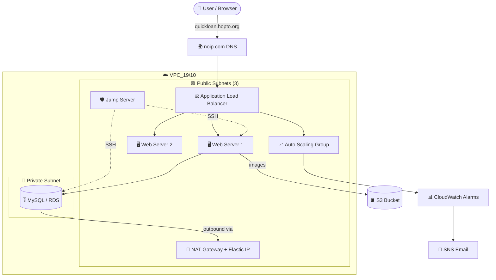

<div align="center">

# 🏦 AWS QuickLoan Site-Portal

### ☁️ A Highly Available, Auto-Scaling, 3-Tier Web Application on AWS


**🛠️ Tools Covered:** `VPC` · `EC2` · `Load Balancing` · `Auto Scaling` · `S3` · `MySQL` · `CloudWatch` · `SNS`

</div>

---

## 📑 Table of Contents

| # | Section | What you will build |
|---|---------|---------------------|
| 0 | [🏗️ Architecture Overview](#-architecture-overview) | Big-picture design |
| 1 | [🌐 Part 1 – VPC & Jump Server Setup](#-part-1--vpc--jump-server-setup) | Network, subnets, IGW, NAT, route tables, bastion host |
| 2 | [🖥️ Part 2 – Nginx, PHP & Application Hosting](#️-part-2--install-nginx--php--host-the-application) | Web server + S3 image hosting |
| 3 | [🗄️ Part 3 – MySQL Database & App Integration](#️-part-3--mysql-database-on-private-server--app-integration) | Private DB, DB connection, custom domain |
| 4 | [⚖️ Part 4 – AMI, Load Balancer, Auto Scaling, SNS & CloudWatch](#️-part-4--ami-load-balancing-auto-scaling-sns--cloudwatch) | High availability + monitoring |
| 5 | [🧹 Cleanup / Delete Steps](#-cleanup--delete-steps) | Avoid unwanted charges |
| 6 | [🔐 Best Practices & Notes](#-best-practices--notes) | Security and tips |

---

## 🏗️ Architecture Overview



### 📖 Key Definitions

| Term | Meaning |
|------|---------|
| **VPC (Virtual Private Cloud)** | Your own logically isolated virtual network inside AWS. |
| **Subnet** | A range of IPs within a VPC. *Public* = route to Internet Gateway; *Private* = no direct internet route. |
| **IGW (Internet Gateway)** | Lets resources in public subnets talk to the internet (in both directions). |
| **NAT Gateway** | Lets private-subnet resources reach the internet **outbound only** (e.g., for `yum` updates). |
| **Elastic IP (EIP)** | A static public IPv4 address, required by the NAT Gateway. |
| **Route Table (RT)** | A set of rules (routes) that decide where network traffic is directed. |
| **Jump / Bastion Server** | A hardened public EC2 used as the single, controlled SSH entry point into private instances. |
| **AMI** | Amazon Machine Image: a snapshot template used to launch identical EC2 instances. |
| **Launch Template** | A saved configuration (AMI, instance type, key pair, SG, network) used by Auto Scaling. |
| **Target Group** | A group of instances the Load Balancer sends traffic to (with health checks). |
| **ALB (Application Load Balancer)** | A Layer-7 (HTTP/HTTPS) load balancer that distributes traffic across targets. |
| **ASG (Auto Scaling Group)** | Automatically adds or removes instances based on demand and policies. |
| **SNS** | Simple Notification Service, a pub/sub messaging service (email/SMS alerts). |
| **CloudWatch** | AWS monitoring service for metrics, logs and alarms. |

---

## 🌐 Part 1 – VPC & Jump Server Setup

> 🎯 **Goal:** Build a secure network with public and private subnets, internet access, and a bastion host.

**Components:** `VPC` · `Subnets (Public & Private)` · `IGW` · `NAT Gateway` · `Public & Private Route Tables` · `Elastic IP`

### 🔹 1.1 Create the Network

| Step | Action | Name / Value |
|:----:|--------|--------------|
| 1️⃣ | **Create VPC** | `VPC_19/10` |
| 2️⃣ | **Create 4 Subnets** → 3 Public + 1 Private | `Public_subnet1_19/10`, `Public_subnet2_19/10`, `Public_subnet3_19/10`, `Private_subnet_19/10` |
| 3️⃣ | **Create IGW & attach to VPC** | `IGW_19/10` → Attach to `VPC_19/10` |
| 4️⃣ | **Create NAT Gateway** (Availability: *Zonal*), place in `Public_subnet1_19/10`, **allocate Elastic IP** | `NAT_gateway_19/10` |
| 5️⃣ | **Create 2 Route Tables** (Public RT & Private RT) and associate with `VPC_19/10` | `Public_RT`, `Private_RT` |
| 6️⃣ | **Associate Public RT with all public subnets** → *Actions → Edit subnet associations* | 3 public subnets |
| 7️⃣ | **Public internet access** → Public RT → *Actions → Edit routes* | Destination `0.0.0.0/0` → Target **Internet Gateway** `IGW_19/10` |
| 8️⃣ | **Private internet access** → Private RT → *Actions → Edit routes* | Destination `0.0.0.0/0` → Target **NAT Gateway** `NAT_gateway_19/10` |

> 💡 **Why NAT in a public subnet?** The NAT Gateway itself needs an IGW route. Private instances send traffic to NAT, and NAT forwards it to the internet.

> 📝 Also associate the **Private RT** with the **private subnet** so it uses the NAT route.

### 🔹 1.2 Create the Jump Server (Bastion Host)

> 🛡️ *"A jump server (also called a bastion host or jump box) is a secured public-subnet EC2 instance used as a controlled entry point to SSH into private instances inside a VPC, so private servers do not need public IPs."*

| Step | Action |
|:----:|--------|
| 1️⃣ | Create **3 public EC2 instances** (Amazon Linux AMI 6.1): `Jump_server_19/10` in **Custom VPC_19/10** → **Public_subnet1_19/10**. ✅ **Auto-assign Public IP = Enable**. |
| 2️⃣ | Create `Web_server1` in `VPC_19/10` → **Public_subnet2_19/10** and `Web_server2` in `VPC_19/10` → **Public_subnet3_19/10**. Security Group must allow **port 80 (HTTP) / 443 (HTTPS)** (plus SSH 22). |
| 3️⃣ | **Connect to Web_server1 from the Jump Server** (run the 3 commands below *inside* the jump server). |

```bash
# a) Create the key file and paste the .pem content into it
vim Web_server_keypair.pem

# b) Restrict permissions (SSH rejects keys that are too open)
chmod 400 Web_server_keypair.pem

# c) SSH into the target instance using its private IP
ssh -i Web_server_keypair.pem ec2-user@<private_ip>
```

> ⚠️ **Delete VPC Note:** First delete the **NAT Gateway** and release the **Elastic IP**; after that you can delete the VPC directly.

---

## 🖥️ Part 2 – Install Nginx & PHP & Host the Application

> 🎯 **Goal:** Configure the web/app server with Nginx + PHP-FPM, deploy the project, and serve images from S3.

### 🔹 2.1 Install Nginx and PHP on `Web_server1`

*(Web-server / App-server: use any name for the instance.)*

```bash
# Switch to root first
sudo su -

yum update -y                       # a. update packages
yum install -y nginx                # b. install Nginx
systemctl start nginx               # c. start Nginx
chkconfig nginx on                  # d. enable on boot  (or: systemctl enable nginx)
# e. Verify: open  http://<public-ip>:80  in the browser

yum install -y php8.2 php-fpm php-mysqlnd php-pdo php-mbstring   # f. install PHP + modules
php -v                              # g. verify PHP version
systemctl start php-fpm             # h. start PHP-FPM
chkconfig php-fpm on                # i. enable on boot  (or: systemctl enable php-fpm)
systemctl restart nginx             # j. restart Nginx
```

> 📖 **Nginx** = high-performance web server / reverse proxy. **PHP-FPM** = FastCGI process manager that executes PHP code for Nginx. **php-mysqlnd** = the driver that lets PHP talk to MySQL.

### 🔹 2.2 Deploy the Project Files

*(For now we use the project folders from the local system. If the project is on **GitHub**, use `git clone` to download and host the site.)*

📂 Copy the **three project folders** from your laptop to the app server using **WinSCP**: `includes`, `nginx`, `public`

Folders land in `/home/ec2-user`. Move them to the Nginx web root:

```bash
mv /home/ec2-user/includes /usr/share/nginx/html           # 1
mv /home/ec2-user/public   /usr/share/nginx/html           # 2
chown -R nginx:nginx /usr/share/nginx/html/public          # 3  set ownership
chmod -R 755 /usr/share/nginx/html/public                  # 4  set permissions
```

### 🔹 2.3 Create an S3 Bucket for Project Images

> 📖 **Amazon S3** = highly durable object storage. We keep the images in S3 and reference the bucket URL in the code so the site loads images from S3 (this also keeps AMIs/instances lightweight).

| Step | Action |
|:----:|--------|
| a | **Bucket name:** `aws-project-bucket-21102026` |
| b | **Object Ownership** → **ACLs enabled** |
| c | **Untick Block Public Access** → select *Turn off block all public access* (acknowledge) → **Create bucket** |
| d | Bucket created → **Upload** the `images` folder from the AWS project `public` folder |
| e | Copy the images folder URL and update `index.html` (see below) |
| f | Update `apply.php` with the bucket image URL (see below) |

**e. Update `index.html`** — replace the old bucket URL with your bucket URL:

```bash
vim /usr/share/nginx/html/public/index.html
# inside vim:
:%s/loanapp332211.s3.eu-west-2.amazonaws.com/aws-project-bucket-21102026.s3.us-east-2.amazonaws.com/g
```

**f. Update `apply.php`** — put the S3 URL in front of the `img src`:

```bash
vim /usr/share/nginx/html/public/apply.php
```
```html

```

> ⚠️ Use **your own bucket name & region** in the URLs. Images must be **publicly readable** (ACL / bucket policy) for the site to display them.

---

## 🗄️ Part 3 – MySQL Database on Private Server & App Integration

> 🎯 **Goal:** Create a private database, connect it to the app server, and attach a custom domain.

### 🔹 3.1 Create the Security Group (SG) First

**EC2 → Security Groups → Create** → Name: `SG-mysql-30` → VPC: **Custom VPC**

| Type | Protocol / Port | Source |
|------|-----------------|--------|
| SSH | TCP 22 | Anywhere-IPv4 |
| MYSQL/Aurora | TCP 3306 | Anywhere-IPv4 |

### 🔹 3.2 Create the Database EC2 Instance

| Setting | Value |
|---------|-------|
| a. Name | `database-server` |
| b. AMI | Amazon Linux 6.1 |
| c. Instance type | As per requirement |
| d. Key pair | `.pem` key (used to enter the DB instance via the jump server) |
| e. Network | **Custom VPC** → **Private subnet** → Security Group `SG-mysql-30` |

➡️ **Launch Instance**

> 📝 **Note:** On Amazon Linux 6.1 the MySQL server package cannot be installed directly, so we install the MariaDB/MySQL **client** (`mariadb105`) here and use **Amazon RDS** as the actual database engine.

### 🔹 3.3 Create the Database (RDS / Aurora)

**a.** Go to **RDS → Create database → Full configuration**

**b. Settings**

| Option | Value |
|--------|-------|
| Engine | **MySQL** |
| Template | **Free tier** |
| Deployment | **Single-AZ DB instance** (1 instance) |
| Engine version | Default |
| Master username | `admin` |
| Credentials | Self managed |
| Master password | `admin@123` *(demo only, see [Best Practices](#-best-practices--notes))* |
| Connectivity | **Connect to an EC2 compute resource** → select `database-server` |
| Additional VPC Security Group | `SG-mysql-30` |

➡️ **Create Database** *(wait 5–10 minutes for the database **endpoint** link)*

**c. Enter the DB server via the Jump Server** *(3 things are always required: key file, permission, SSH)*

```bash
vim database-server-keypair.pem                 # paste the key pair .pem data
chmod 400 database-server-keypair.pem
ssh -i database-server-keypair.pem ec2-user@<private_ip_of_database_server>
```

**d–l. Install client, connect and create schema**

```bash
yum install mariadb105 -y                         # d. install MySQL client
mysql -h <endpoint> -u <username> -p<password>    # e. connect to the database
```

```sql
CREATE DATABASE quickloan_db;          -- f.
show databases;                        -- g. list databases
USE quickloan_db;                      -- h.

CREATE TABLE applications (            -- i. creates the applications table
    id INT AUTO_INCREMENT PRIMARY KEY,
    name VARCHAR(255) NOT NULL,
    contact VARCHAR(20) NOT NULL,
    email VARCHAR(255) NOT NULL,
    loan_type VARCHAR(50) NOT NULL
);

show tables;                           -- j. shows: applications
select * from applications;            -- k. all rows & all columns
desc applications;                     -- l. structure: columns, data types, null rules, keys, defaults
```

**m. Exit 3 times** 🚪

| Exit # | Command | You are now in… |
|:------:|---------|-----------------|
| 1 | `exit` | Out of the RDS database → *database server* |
| 2 | `exit` | Out of database server → *ec2-user (jump server session)* |
| 3 | `exit` | Back on the **jump server** |

### 🔹 3.4 Connect App Server → DB Server

Now you are on the jump server:

```bash
ssh -i app-server-keypair.pem ec2-user@<private_ip_of_app_server>
sudo su -
cd /usr/share/nginx/html/includes        # configuration lives in the includes folder
vim db_connect.php
```

In `db_connect.php` add the **DB endpoint URL** (servername), **database username**, **database password** and **dbname**.

> ❗ This entry is **very important** for connecting the DB to the app server. Once the entries are saved in `db_connect.php`, the connection is done.

Example (adapt to your file):

```php
<?php
$servername = "<RDS-ENDPOINT-URL>";
$username   = "admin";
$password   = "admin@123";
$dbname     = "quickloan_db";

$conn = new mysqli($servername, $username, $password, $dbname);
if ($conn->connect_error) {
    die("Connection failed: " . $conn->connect_error);
}
?>
```

### 🔹 3.5 Attach a Domain Name with noip.com 🌍

| Step | Action |
|:----:|--------|
| a | Go to **noip.com** |
| b | **Managed DNS → DNS Records → Create Hostname** (Type **A** → public IP; **CNAME** → DNS link). Example host: `quickloan` |
| c | `ssh -i app-keypair.pem ec2-user@<private_ip_of_app_server>` *(put the hostname entry in the app/web server)* |
| d | `vim /home/ec2-user/nginx/quickloan.conf` |
| e | Set `server_name quickloan.hopto.org;` |
| f | `mv /home/ec2-user/nginx/quickloan.conf /etc/nginx/conf.d` *(move the config once server name is set)* |
| g | `nginx -t` → confirms **syntax is ok** & **configuration test is successful** |
| h | `systemctl restart nginx` |

✅ Now open **`quickloan.hopto.org`** in the browser and access the QuickLoan site.

**i. Exit twice** to return to the jump server: 1st `exit` → root → ec2-user; 2nd `exit` → ec2-user → jump server.

---

## ⚖️ Part 4 – AMI, Load Balancing, Auto Scaling, SNS & CloudWatch

> 🎯 **Goal:** Make the application highly available, self-healing, and monitored.

### 🔹 4.1 Create an Image (AMI) of the App/Web Server

> 📖 The AMI is used to create the **Launch Template**, which powers **Auto Scaling** and **Load Balancing**.

1. Select the EC2 instance (app-server / web-server)
2. **Actions → Image & templates → Create image**
3. Image name: `app-server/web-server-image_23` and **untick "Reboot instance"** → **Create image**
4. Verify under **Images → AMIs**

### 🔹 4.2 Create Target Group & Load Balancer

**A. Target Group** (EC2 → Load Balancing → Target groups)

1. **Create target group** → Name `TG_23/10` → Select **Custom VPC** → Next
2. **Register targets:** do **not** select any target (instances will be created automatically from the AMI by Auto Scaling) → Next
3. **Review & Create** → **Create target group**

**B. Application Load Balancer**

1. Select **Application Load Balancer**
2. Enter the load balancer name → select **Custom VPC** → select **Availability Zones & Subnets** matching where the app/web servers were created
3. Select the **Custom Security Group** (Inbound: **SSH–22** & **HTTP–80**)
4. Select the **Custom Target Group** `TG_23/10` → **Create load balancer**

### 🔹 4.3 Create the Launch Template

| Setting | Value |
|---------|-------|
| Name | `LT_23/10` |
| AMI | **My AMIs → Owned by me** → your custom AMI |
| Instance type / Key pair | Select instance type; create key pair |
| Subnet | One public subnet of the app/web server *(servers are in two public subnets, but only one option is available, so choose any one)* with the matching AZ |
| Security Group | Custom SG |
| Advanced Network Configuration | **Auto-assign public IP → Enable** |

➡️ **Create launch template**

### 🔹 4.4 Create the Auto Scaling Group (ASG)

1. Name: `ASG_23oct` → select the **Custom Launch Template** → Next
2. Select **Custom VPC** → choose the **custom public subnets** and related AZs → Next
3. **Attach to an existing load balancer** → *Existing load balancer target groups* → `TG_23/10` → Next
4. Set **Desired, Minimum and Maximum capacity** → Next → Next → **Create Auto Scaling group**

✔️ **Verify:**
- Instances created by the ASG appear in the EC2 console
- Open the instance **public IP** in the browser to check content
- Also access content using the **Load Balancer DNS**
- Create a **new CNAME record** on noip.com with the **Load Balancer DNS**, and make sure the hostname is registered in the Nginx `conf.d` config on the app/web server:

```bash
vim /home/ec2-user/nginx/quickloan.conf
# server_name quickloan.hopto.org;
```

### 🔹 4.5 Create an SNS Topic for Alarms 📧

1. **SNS → Topics → Create topic**
2. Type **Standard** → Name `Topic_23oct` (+ display name) → **Create topic**
3. **Create subscription** → Protocol **Email** → add endpoint email → **Create subscription**
4. Check your mail and click **Confirm subscription** (*AWS Notification – Subscription Confirmation*)
5. In **Amazon SNS → Subscriptions**, status should be **Confirmed** ✅

### 🔹 4.6 Create CloudWatch Alarms 📊

> You will receive an email notification when CPU utilization rises or falls beyond the thresholds.

**🔺 Alarm 1: CPU > 80%**

1. **CloudWatch → Alarms → Create alarm**
2. **Select metric → EC2 → By Auto Scaling Group** → choose **CPUUtilization** for `ASG_23oct` → *Select metric*
3. **Conditions:** Static → CPUUtilization **Greater than… 80** → Next
4. **Notification → In alarm →** *Select an existing SNS topic* → `Topic_23oct` → Next
5. **Alarm name:** `alarm for cpu > 80%` → Next → **Create alarm**

*(Initial state will be **Insufficient data**. When instance CPU goes above 80% you will receive a mail.)*

**🔻 Alarm 2: CPU < 20%**

1. **CloudWatch → Alarms → Create alarm**
2. **Select metric → EC2 → By Auto Scaling Group** → **CPUUtilization** for `ASG_23oct` → *Select metric*
3. **Conditions:** Static → CPUUtilization **Lower than… 20** → Next
4. **Notification → In alarm →** existing SNS topic `Topic_23oct` → Next
5. **Alarm name:** `alarm for cpu < 20%` → Next → **Create alarm**

### 🔹 4.7 Create Scaling Policies (Alarm → Action) 🔁

> Link CloudWatch alarms to the ASG so instances are **added or removed automatically**.

1. **EC2 → Auto Scaling groups →** select `ASG_23oct`
2. **Automatic scaling → Create dynamic scaling policy**

| Policy | Policy type | Name | CloudWatch alarm | Action |
|--------|-------------|------|------------------|--------|
| 📈 Scale-out | Simple scaling | `server_creation_policy` | `alarm for cpu > 80%` | **Add – 1** instance |
| 📉 Scale-in | Simple scaling | `server_removal_policy` | `alarm for cpu < 20%` | **Remove – 1** instance |

---

## 🧹 Cleanup / Delete Steps

> 💸 Delete resources **in this order** to avoid dependency errors and unwanted charges.

| Order | Resource | Notes |
|:-----:|----------|-------|
| 1️⃣ | **Auto Scaling Group** | Terminates its instances |
| 2️⃣ | **RDS** | Untick *Create final snapshot* → tick *I acknowledge* |
| 3️⃣ | **NAT Gateways** (VPC) | Billed hourly |
| 4️⃣ | **Load Balancers**, **Target Groups**, **terminate all Instances**, **Launch Template**, **AMIs** | AMIs: *Deregister* with **Delete associated snapshots** (EC2) |
| 5️⃣ | **Release Elastic IP addresses**, then **delete Custom VPC** | VPC section |
| 6️⃣ | **S3 buckets** | **Empty** the bucket first (mandatory), then delete |
| 7️⃣ | **CloudWatch alarms** | |
| 8️⃣ | **SNS topics & subscriptions** | |

---

## 🔐 Best Practices & Notes

- 🔑 **Never commit `.pem` keys** or passwords to GitHub. Add them to `.gitignore`.
- 🔒 `admin@123` and **SSH/MySQL open to Anywhere (0.0.0.0/0)** are fine for a learning lab only. In production restrict SSH to the **Jump Server SG** / your IP, and allow MySQL (3306) **only from the web server SG**. Use **AWS Secrets Manager** for credentials.
- 🌐 Use **HTTPS (ACM certificate on the ALB)** in production.
- 🪣 Prefer an S3 **bucket policy / CloudFront** over public ACLs for serving images.
- 🧩 Keep consistent names for resources (e.g., `VPC_19/10`) and the same region for all services; the S3 URL region must match your bucket.
- 📦 If the project is on **GitHub**, use `git clone` instead of WinSCP.
- ⏱️ Auto Scaling **cooldown** applies between scaling actions, so allow a few minutes to see instances added/removed.

---

<div align="center">

### ⭐ Happy Cloud Building! ⭐
**Made with ❤️ for the AWS QuickLoan Site-Portal Project**

</div>
